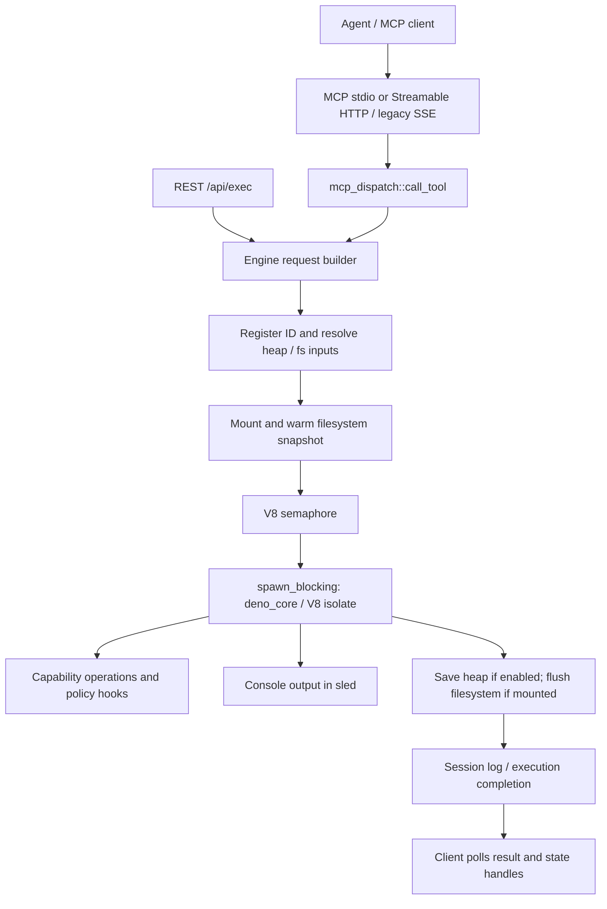

# mcp-js: implementation evidence reference (base fe5b613)

Prepared for Robert. Audience: **interviewers evaluating Robert’s work**, confirmed after the initial provisional assumption. Challenge brief and interview date/time remain unknown. This guide does not infer Robert’s authorship, design intent, or personal contribution from Git history.

**Version:** the clean checkout at `/workspace/mcp-js` is exactly [`fe5b613db0afcc9cf20d7ca1ef659c914a0b5008`](https://github.com/r33drichards/mcp-js/commit/fe5b613db0afcc9cf20d7ca1ef659c914a0b5008), inspected October 23, 2026 UTC. This is a checkout finding, not a claim that upstream has no newer commits. The referenced earlier COW commit and inspected HEAD are identical; relevant COW files have no working-tree diff. Earlier descriptions still need correction where they contradict implementation.

**Evidence standard:** “Implemented” below means inspected source, not a successful run. This reference was written during read-only inspection. See verification.md for subsequent executed tests; symbolic examples below remain examples. Links [E1]–[E20] at the end pin exact files and symbols to this commit.

## The story to tell

Suggested opening, to adapt after filling in the contribution worksheet:

> “This runtime lets an agent submit JavaScript or TypeScript through MCP, execute it in V8, and carry selected state into later calls. I’ll follow one request, then show how filesystem snapshots let two executions diverge without overwriting their shared base. Finally, I’ll explain where isolation, durability, and concurrency guarantees stop.”

The story has three anchors: **execute a program; preserve explicit state; publish changes deliberately**. Keep the screen on one architecture diagram, one small file, and one branch diagram. Use other files only to answer a specific question.

Before rehearsal, Robert should fill in these factual statements:

- My actual contribution was: **[components, PRs, implementation/review/operations role]**.
- The requirement I was responsible for was: **[real constraint and source]**.
- I considered **[actual alternatives]** and chose **[actual choice]** because **[evidence available then]**.
- One change I made after a failure or review was: **[real incident and resulting test]**.
- I did not implement / cannot speak from personal experience about: **[boundaries]**.
- My measured result was: **[measurement, workload, hardware, baseline]**, or “I have not measured this.”

Never substitute the suggested tradeoff explanations below for this decision history. If asked “why did you choose it?” and the history is unknown, say: “I can explain the tradeoff in the implementation; I would need to distinguish that from the original decision.”

## Establish the contract

Explain that the repository is named `mcp-js`, while the server is presented as `mcp-v8`. Rust hosts V8 through `deno_core`; TypeScript types are stripped, not type-checked. MCP transports and a REST API reach the same engine. The repository also includes clients and language bindings, which are context rather than the focus of this hour. [E1, E2, E3]

**Correct the default-state claim:** current `Cli.heap_store` and `Cli.fs_store` both default to `StoreKind::None`. Heap and filesystem persistence are independent axes. The README’s “default stateful” wording and older quick-start flags should not drive the demonstration. Use current parser/source semantics. Heap snapshots require snapshot mode and are incompatible with configured WASM modules; filesystem-only persistence supports the alternative. [E1, E4]

Ask the evaluators only about the desired depth, without assuming a challenge brief: “I’ll focus on runtime and persistence; please steer me if you want more depth in one.” Then state Robert’s actual contribution using the worksheet.

## One concrete request

**Current preparation mode is a source walkthrough.** A later live rehearsal requires an already approved, known build and a disposable configured instance. No server, test suite, installer, or example has been run during preparation. Do not run README `curl | sudo bash` instructions during the interview.

Use an existing MCP client and `tools/call` if available. The REST equivalent is `POST /api/exec`, then `GET /api/executions/{id}`, and `GET /api/executions/{id}/output`. Use only the disposable environment; these calls create snapshots and later steps move labels. [E2, E3]

Prerequisites for the filesystem example: filesystem storage enabled (`--fs-store dir`), filesystem operation policy allowing `readFile` and `writeFile` on the demonstration path, configured execution registry, and default `fs_passthrough=false`. Use a unique nonexistent label such as `walkthrough-<unique-id>`; do not reuse someone’s `main` label. The unknown label starts an empty overlay but is not automatically created by execution. No network, module imports, or subprocesses are needed. Explicit handles avoid depending on session defaults. [E4, E5]

### Step A — Write the base

MCP tool name `run_js`, arguments:

```json
{
  "fs": "walkthrough-<unique-id>",
  "code": "(async () => { await fs.writeFile('/work/notes.txt', 'alpha\\nbeta\\ngamma\\n'); console.log(await fs.readFile('/work/notes.txt', 'utf8')); })()"
}
```

**Use the machine-readable `demo-requests.json` for correct JSON escaping.** In a client text editor, the actual JavaScript string must contain `\n` escapes, so the file has three lines. The machine-readable artifact provides the exact payload; this display is illustrative.

Poll `get_execution` with `{"execution_id":"<returned-id>"}` until a terminal status. On success, save its `fs` field as **B**. Fetch console output with `get_execution_output`. Expected content is `alpha`, `beta`, `gamma` on separate lines. Exact IDs and output framing are not predicted. Check `status` and `error`; a returned execution ID alone is not success.

**Explain what happened:** `mcp_dispatch::run_js` builds the request. `Engine::run_js_inner` strips TS types, registers an ID, resolves input state, and schedules work. `build_fs_mount` resolves or creates the overlay. `execute_in_background` runs V8 and, on success, `push_mount` saves a snapshot before marking completion. A snapshot was produced; the shared label was not moved. [E2, E5]

### Step B — Prove readback, not just console success

Call `run_js` with `fs=B` and:

```javascript
(async () => {
  const s = await fs.readFile('/work/notes.txt', 'utf8');
  if (s !== 'alpha\nbeta\ngamma\n') throw new Error('readback mismatch');
  console.log(s);
})()
```

Expected: successful read of the original bytes, and an unchanged filesystem root for a read-only run. The tiny example uses inline file bytes; it does **not** demonstrate chunk deduplication. Cite `mount_write_push_then_read_back_by_ca_id` as the nearest end-to-end test, then leave the branch continuation for minute 33. [E6, E7]

**Eight-minute pacing:** 1 minute setup/contract, 2 write and poll, 2 readback, 2 request trace, 1 distinguish execution ID, heap ID, filesystem ID, and label. If any live step stalls for 30 seconds, switch to the fallback immediately.

## Runtime and isolation



State the boundaries in this order:

1. **Execution:** a fresh runtime is constructed for each execution; stateful runs restore serialized heap data. Stateless uses `JsRuntime`; stateful uses `JsRuntimeForSnapshot`. This is not a permanently resident per-user process. The execution layer uses Tokio background tasks and a blocking pool; module execution drives its own current-thread runtime. [E5]
2. **Concurrency:** `v8_semaphore` bounds concurrent V8 executions. Stateful work also takes `snapshot_mutex` around `execute_stateful`, so “all calls execute in parallel” is too broad. Filesystem label CAS is a separate concurrency control; it does not serialize all session behavior. [E5]
3. **Termination and resources:** timeout invokes V8 `terminate_execution`; heap limits and a bounded ArrayBuffer allocator address different allocation paths. These are not a complete process RSS quota. Mount warming and semaphore waiting occur before the timeout selection. The timeout branch waits for the worker; do not promise a hard end-to-end wall-clock bound for host I/O. [E5]
4. **Capabilities:** host operations route through Rust APIs and policy/hook checks. Configured hooks can rewrite inputs; policy evaluates effective inputs. A V8 isolate alone is not a host security boundary for every native dependency. Filesystem snapshot operations have a separate optional gate; `check_fs_snapshot_policy` returns success when no such chain is configured. Do not claim every operation always has a default-deny OPA check. [E4, E5, E8]
5. **Hardening:** `neutralize_dangerous_ops` is part of the normal setup. This commit closes the alternate `__bootstrap.core.print` path that could bypass stdio framing. Additional `HardeningConfig` mitigations are opt-in and default off. Use this as a concrete security lesson: removing one reference to a privileged function does not remove aliases captured elsewhere. Do not claim Robert authored the fix without confirmation. [E9]
6. **OS confinement:** optional `--sandbox-manifest` applies nono constraints to the whole server before threads start, using Landlock/Seatbelt. It is a process-wide defense layer, not one container per execution. Unsupported supervisory features, including nono rollback, are rejected. Filesystem label reset is a different feature. [E10]

Prompt for Robert’s defense: “Which boundary was actually part of your requirement? Which protections did you configure, and what did you test?”

## COW, bytes on disk, persistence

### Two planes and an ephemeral view

`SessionMount` has a pinned `base_id` plus `upper: HashMap<PathBuf, Write>`. `Write::Data(Entry)` shadows the base; `Write::Whiteout` deletes an entry from the effective snapshot. A read checks the upper layer, then resolves a base path through the tree. `SessionMount::copy` copies an entry by reference; a normal write stores new content and updates the upper. This is an in-process overlay, not kernel overlayfs or FUSE. [E7]

`SessionMount::push` folds changes into a new root through `FsStore::build_root`. Untouched subtrees retain their hashes. The root describes content, not a parent commit: the content tree has no lineage field. Labels and reflogs provide mutable names and movement history. Thus two different histories can yield the same filesystem root. Do not equate this with a full Git commit DAG. [E7, E11, E12]

Draw this concrete change:

```text
Before: label L -> B -> { work -> W0, vendor -> V }
                            W0 -> notes.txt = inline "alpha\nbeta\ngamma\n"
Run A:  base B + upper { work/notes.txt -> new Entry }
After:  output A -> { work -> W1, vendor -> V }
                      W1 -> notes.txt = inline "ALPHA\nbeta\ngamma\n"
Label L still points to B until an explicit push succeeds.
V is shared. B remains readable. A and B are full views via shared objects.
```

### Disk representation, precisely

| Item | Representation and identity | Where it lives |
|---|---|---|
| Directory node | `TreeNode { children: BTreeMap<String, TreeChild> }`, serialized with bincode; BLAKE3 of encoded bytes | Blob key `fstree:<64-hex>` |
| Child | Optional `file: Entry` and optional `dir: [u8;32]`; both can coexist | Inside directory-node bytes |
| File entry | `mode`, `size`, `content`, `symlink` | Inside directory node |
| File ≤64 KiB | `Content::Inline(Vec<u8>)` | Bytes embedded in node; no separate chunk blob |
| Larger file | `Content::Chunks(Vec<[u8;32]>)`; ordered content-defined chunks | Chunk keys `fschunk:<plaintext-BLAKE3>` |
| Chunk body | One-byte raw/zstd tag, followed by raw or zstd level-3 payload; compression retained only if smaller | Blob value |
| Filesystem snapshot | Hash of top-level directory node | No separate “commit object” required |
| Label and reflog | Sled trees `fs_label_heads` and `fs_label_log`; replicated key prefixes `fl:head:` and `fl:log:` in cluster mode | Pointer metadata store |
| Heap snapshot | `MCPV8SNAP\0`, SHA-256 checksum, V8 payload; key is SHA-256 of payload | Configured heap blob backend |

Sources: [E5, E11, E12, E13, E14]. `Manifest` remains a flat convenience view; it is not the current canonical snapshot encoding. `fs_merge.rs` begins with an older flat-merge description, but the engine calls `merge_trees`. Explain the executed call path instead of quoting that header alone.

On a directory backend, `FileHeapStorage` uses a plain file named by the blob key under its configured directory. For CLI filesystem storage, the default is `<session-db-path>/fs-blobs`; labels default to `<session-db-path>/fs-labels`. Heap and fs stores share a storage interface and can share a backend, but the CLI may configure separate directories. These are binary objects, not a human-readable directory mirror or JSON manifest. [E4, E13, E15]

FastCDC uses 256 KiB minimum, 1 MiB target average, and 4 MiB maximum. Boundary chunks may be smaller. The 64 KiB inline threshold is distinct from these chunk parameters. Content-defined chunking can preserve dedup after shifted edits better than fixed offsets; that is a suggested design rationale, not a measured result or Robert’s stated motivation. [E14]

### What the performance claim does and does not mean

Structural sharing limits changed paths and reuses equal subtrees. However:

- Rewriting a directory node serializes that node’s complete child map; very wide directories still cost work.
- Changed file bytes must be processed; ordinary `read_file` assembles the full file in memory. Streaming writes use `FileWriter`; do not claim all operations have bounded memory.
- `build_fs_mount` calls `warm`, which calls `FsStore::prefetch` over the entire reachable base tree and warms chunks. The source explains this as avoiding cross-runtime remote-I/O problems. Thus lazy path lookup does not establish O(touched-paths) end-to-end execution startup.
- Content merging reads conflicting file bodies. A small edit to a large file can still have substantial I/O and memory cost.

These are source-derived cost boundaries, not benchmark results. [E5, E7, E11, E14]

### Persistence is several different promises

Heap and filesystem output IDs are independent. Session history records output IDs so later calls can resume without tracking them manually; explicit handles take precedence. `SessionLog::fork` seeds a new session from a source’s latest entry, with an existing target treated as a no-op. This is session state reuse, not a general branch graph or automatic merge base. [E5, E16]

Directory and S3 backends support blob persistence; write-through caching writes cache then primary, and reads cache before primary. A failed primary write may leave a local cache object. `FileHeapStorage::put` uses `std::fs::write`, without an explicit temp-file/rename/fsync sequence here. Present persistence as implemented storage, not a proven power-loss transaction. Heap saving, filesystem flushing, session logging, and label advancement are separate steps. A session-log append failure is warned about while execution can still complete, so “completed” is not a proof that the next session lookup will resume it. [E5, E13]

## Branch, merge, publish, reset, collect

Use the remaining requests in `demo-requests.json`, substituting actual returned IDs. Live continuation is optional; the same sequence works as a source-backed tabletop exercise.

1. **Name the base:** `fs_push` with `label=L, ca_id=B`, no expected value, creates the previously absent label. For an existing label, supply its expected head.
2. **Branch:** run twice with the same explicit `fs=B`. A changes line 1 to `ALPHA`; T changes line 3 to `GAMMA`. Save the returned roots A and T. Read B again to show the original bytes remain.
3. **Merge:** `fs_merge` with `ours=A, theirs=T, base=B` should return a merged root M with `ALPHA\nbeta\nGAMMA\n`. A base is caller-supplied; the implementation does not infer an LCA from a content-only root. Omitting the base gives two-way behavior. [E17]
4. **Publish:** `fs_push` with `label=L, expected=B, ca_id=M`. Expect `Advanced` as serialized by the API (`status` discriminator in the tool response). Repeat with stale `expected=B` and another root to illustrate rejection; read the current label again rather than assuming the rejection’s diagnostic value is a new atomic read. [E12, E18]
5. **Rollback:** `fs_reset` with `label=L, ca_id=B`. Default behavior checks that B occurs in the label’s reflog, then force-moves the pointer. It does not rewind a running pinned mount, a session’s latest entry, the heap, a network call, or a subprocess side effect. To consume the reset, the next run explicitly mounts L. `allow_unlogged=true` relaxes the reflog check; it does not prove the target blobs exist. [E18]

Optional conflict: change the same line differently on both sides. Expect structured conflicts with kind and side identifiers; text conflicts have markers and diffs. Text uses a line-level `diffy` merger. SQLite is identified as a kind but has no automatic database changeset merge. Binary and modify/delete conflicts require a decision. `prefer=ours|theirs` can discard the other side’s conflicting edits; it is not semantic reconciliation. A successful merge does not move a label until a separate push. [E17]

**CAS guarantee:** a local mutex serializes label read/compare/write; cluster mutations use Raft coordination, and cluster head+reflog writes travel together. A local mutex does not itself make the two local sled operations crash-atomic. The formal model targets the cluster combined-write design, not all system durability. Label metadata replication does not replicate node-local blob files; cluster use needs shared blob storage. [E12, E15, E19]

**Pruning/GC is narrower than the word “rollback” suggests.** `fs_gc::collect` is an implemented mark-and-sweep library function. It roots every label head and selected reflog **to** IDs, walks tree nodes and chunks, and deletes unmarked filesystem-prefixed objects. `KeepAll` retains every reflog result; `KeepLast(n)` limits which entries root objects. It does not delete reflog records. No caller wiring a GC command, endpoint, or scheduled service was found in the inspected server. [E20]

Do not promise safe online GC as delivered: active mounts, session-only output roots, and detached roots are not added by `collect`. Missing/unreadable tree nodes are skipped during marking. S3 implements put/get but not the list/delete methods needed by GC; the trait defaults return errors, and the cache delegates enumeration to primary. These are implementation limits and risks to address before operational pruning. Never run GC during this demo. [E13, E20]

## Testing and observability

Show three invariants in detail and keep the rest as a reference:

| Invariant / concern | Exact test evidence | What this inspection establishes |
|---|---|---|
| An execution produces a remountable fs root | `server/tests/fs_snapshot_e2e.rs::mount_write_push_then_read_back_by_ca_id` | Test exercises async Engine path and verifies stored bytes |
| Unchanged subtrees share identity | `server/tests/fs_tree.rs::push_shares_unchanged_subtrees` | Test compares subtree hashes |
| Same path, different lines can merge | `server/tests/fs_merge_engine.rs::text_edits_to_different_lines_auto_merge_through_engine` | Expected content is asserted, not just a success status |
| CAS prevents competing publication | `server/tests/fs_labels.rs::cas_advances_only_from_expected_head`; `server/tests/fs_cluster.rs::two_followers_race_a_push_exactly_one_wins` | Local and cluster intentions are covered |
| Cluster head/reflog move together | `server/tests/fs_cluster.rs::head_and_reflog_commit_together_across_nodes`; `specs/FsLabelAtomicWrite.tla` | Runtime test plus bounded formal model exist |
| GC preserves retained history and shared chunks | `server/tests/fs_gc.rs::reset_then_gc_does_not_collect_rolled_past_snapshot`, `gc_preserves_shared_chunks_across_snapshots` | These roots are covered; session/live roots are a separate gap |
| Default print alias neutralization | `server/tests/sandbox_print_bypass.rs::bootstrap_core_print_is_neutralized_by_default` | Regression test uses default neutralization, not opt-in hardening |
| Large streaming files | `server/tests/fs_large_file.rs::huge_file_streams_with_bounded_memory` | Test exists but is ignored by default; no performance claim from presence |

These tests were read, not run. `.github/workflows/test.yml` contains build and serialized cargo-test steps; a workflow file is not evidence that this commit’s CI passed. Formal-spec README results are repository-reported, not independently reproduced here. [E6, E7, E9, E17, E19, E20]

Observability: execution UUID; status `running/completed/failed/cancelled/timed_out`; error, timing and output handles; console output paginated by line or byte; label reflogs with messages; `tracing` warnings and errors for storage/session failures. `ExecutionRegistry` holds status records in an in-memory `DashMap`, while console trees are sled-backed. Do not promise restart recovery of status records merely because logs persist. [E2, E3, E12]

Suggested next measurements, not established findings: mount-warm latency vs snapshot size/cache hit rate; wide-directory push cost; peak RSS for full-file reads and merges; stateful queue wait; snapshot/primary-store failure rates; time from execution accepted to fs output published. Separate queue, warm, execute, and flush phases before reporting “execution latency.”

## Defend one choice honestly

Use this four-sentence structure with Robert’s verified history:

> “The constraint was **[actual requirement]**. I chose **[actual decision]** over **[actual alternative]** because **[reason supported then]**. The code enforces **[specific invariant and test]**. The remaining limitation is **[specific boundary]**, and the next validation I would do is **[test or measurement]**.”

Possible technical topics, offered as analysis rather than personal motivation:

| Choice in source | Plausible benefit | Cost / limit |
|---|---|---|
| Rust + embedded V8 | Direct control of host operations and execution lifecycle | Native integration, snapshot constraints, security-sensitive API surface |
| Separate heap and filesystem axes | Preserve files while using fresh heaps/WASM-capable execution | No automatic atomic checkpoint across all state and side effects |
| Content-addressed tree + chunks | Dedup and structural sharing, immutable snapshot handles | Encoding stability, GC, wide-node and changed-file costs |
| Mutable labels with CAS | Explicit conflict detection on shared publication | Caller tracks expected head and merge base; force paths bypass conflict check |
| Rego/hook policy layer | Inspect or constrain each exposed capability operation | Configuration and hook trust become part of the boundary |

A strong limitation to volunteer is the difference between lazy tree lookup and whole-base warm-up. A strong correctness boundary is the difference between label CAS and a transaction across storage, session history, and external side effects.

## Likely questions and defensible answers

1. **“What exactly did you build?”** Answer only from the contribution worksheet. Commit metadata does not prove scope of personal work.
2. **“Why not Node or a container per call?”** Explain the observable isolate/host-op design and potential startup/control tradeoffs. Robert supplies the actual alternatives evaluated. No comparative performance claim without data.
3. **“Is this secure by default?”** Define the threat model: capability exposure, policy checks, default neutralization, optional hardening, optional OS confinement. Show the print-alias regression. Avoid “V8 makes arbitrary code safe.”
4. **“Is the COW store like Git?”** Immutable tree/chunk identities plus mutable names are similar. Roots have no commit ancestry, merge base is explicit, text merge exists, and there is no Git-compatible object format.
5. **“What happens when two agents edit the same file?”** They can independently derive roots from B. Content merge may reconcile text; publishing to one label uses expected-head CAS. A CAS failure is a prompt to reread/merge, not automatic retry that overwrites.
6. **“Does rollback undo everything?”** No. It moves a filesystem label. Pinning keeps existing mounts stable; heap, session pointers and external effects are separate.
7. **“Can the filesystem be terabytes?”** The tree and streaming writer support sharing and bounded working paths, but full-base prefetch, directory width, whole-file reads/merge, cache capacity, and GC traversal matter. Capacity is not a measured throughput claim.
8. **“What if the process dies mid-write?”** Local blob writes lack explicit atomic replacement/fsync here; local label head and reflog are separate operations. Cluster pointer writes are combined. Explain which failure windows need crash tests before promising durability.
9. **“Why does the same content have different heap and fs IDs?”** Different representations and hashes: V8 payload SHA-256 vs canonical filesystem tree BLAKE3. Equal logical JS state need not imply identical serialized heap bytes.
10. **“What survives a restart?”** Configured blobs and persistent metadata are intended to persist; active execution records are in memory. A stored snapshot is not the same as a recovered running execution.
11. **“How does clustering keep files consistent?”** Replicated label CAS coordinates publication; shared blob storage supplies content. Local filesystem blobs are not magically replicated by Raft.
12. **“How does pruning know what is in use?”** The current collector roots labels/reflogs only. Adding session and live-operation roots, synchronization, and fail-closed marking is proposed follow-up work, not a shipped guarantee.
13. **“Can snapshots run on arbitrary V8 versions?”** The wrapper validates magic/checksum, but that is not proof of V8 version portability. Pin the build for the demo; verify compatibility separately.
14. **“Are timeouts hard cancellation?”** They request V8 termination and await worker exit. Warm/queue phases and host operations require separate analysis; do not claim process-level preemption.
15. **“What would you improve next?”** Pick one requirement-driven item: GC reachability/concurrency, atomic local persistence, or warm-up cost. Specify a test/metric and acceptance criterion rather than promising a rewrite.

When a question exceeds the evidence: “I haven’t verified that path. The relevant boundary is **[symbol]**; I would test **[specific case]** before asserting the guarantee.”

## Fallback and rehearsal plan

**Fallback A: no runnable server.** Use the prepared request JSON and show `fs_snapshot_e2e` assertions as the expected behavior. Walk `run_js_inner` → `execute_in_background` → `SessionMount::write/push` → `FsStore::build_root`. Call this a source walkthrough, not a recording or live test result.

**Fallback B: server/policy mismatch.** Stop after 30 seconds, show the failed status, and explain which prerequisite failed. Do not change policies broadly, enable host passthrough, install a new version, or debug unrelated setup during the hour. Continue with the same B/A/T/M diagram.

**Fallback C: time pressure.** Keep the 60-minute clock. Skip live merge, use the exact test `text_edits_to_different_lines_auto_merge_through_engine`, then explain expected-head CAS and reset. Leave at least the reserved 8 minutes for Q&A.

**Rehearsal passes:** first speak the outline without code; second navigate only the six anchor views (CLI defaults, dispatch, background execution, mount/tree, label/merge, tests); third answer five hard questions in 60–90 seconds each. Use a timer at 04, 12, 21, 33, 41, 47, 50, and 60 minutes. Replace every bracketed personal-history field before presenting.

Before any later authorized live rehearsal, use a disposable known build pinned to this commit, verify the independent storage settings and narrow filesystem policy, choose a fresh label, and save actual input/output captures. Subsequent component rehearsals are recorded in verification.md. No interview event or calendar date was inferred from “tomorrow.”

## Commit-pinned evidence index

All links below are to the inspected commit. File line numbers can be verified locally with `rg -n` or `nl -ba`; named symbols are the primary navigation anchors.

[E1]: https://github.com/r33drichards/mcp-js/blob/fe5b613db0afcc9cf20d7ca1ef659c914a0b5008/README.md
[E2]: https://github.com/r33drichards/mcp-js/blob/fe5b613db0afcc9cf20d7ca1ef659c914a0b5008/server/src/mcp_dispatch.rs
[E3]: https://github.com/r33drichards/mcp-js/blob/fe5b613db0afcc9cf20d7ca1ef659c914a0b5008/server/src/api.rs
[E4]: https://github.com/r33drichards/mcp-js/blob/fe5b613db0afcc9cf20d7ca1ef659c914a0b5008/server/src/cli.rs#L196
[E5]: https://github.com/r33drichards/mcp-js/blob/fe5b613db0afcc9cf20d7ca1ef659c914a0b5008/server/src/engine/mod.rs#L2330
[E6]: https://github.com/r33drichards/mcp-js/blob/fe5b613db0afcc9cf20d7ca1ef659c914a0b5008/server/tests/fs_snapshot_e2e.rs
[E7]: https://github.com/r33drichards/mcp-js/blob/fe5b613db0afcc9cf20d7ca1ef659c914a0b5008/server/src/engine/fs_mount.rs
[E8]: https://github.com/r33drichards/mcp-js/blob/fe5b613db0afcc9cf20d7ca1ef659c914a0b5008/server/src/engine/fs.rs
[E9]: https://github.com/r33drichards/mcp-js/blob/fe5b613db0afcc9cf20d7ca1ef659c914a0b5008/server/src/engine/console.rs#L219
[E10]: https://github.com/r33drichards/mcp-js/blob/fe5b613db0afcc9cf20d7ca1ef659c914a0b5008/server/src/sandbox.rs
[E11]: https://github.com/r33drichards/mcp-js/blob/fe5b613db0afcc9cf20d7ca1ef659c914a0b5008/server/src/engine/fs_store.rs
[E12]: https://github.com/r33drichards/mcp-js/blob/fe5b613db0afcc9cf20d7ca1ef659c914a0b5008/server/src/engine/fs_labels.rs
[E13]: https://github.com/r33drichards/mcp-js/blob/fe5b613db0afcc9cf20d7ca1ef659c914a0b5008/server/src/engine/heap_storage.rs
[E14]: https://github.com/r33drichards/mcp-js/blob/fe5b613db0afcc9cf20d7ca1ef659c914a0b5008/server/src/engine/fs_chunker.rs
[E15]: https://github.com/r33drichards/mcp-js/blob/fe5b613db0afcc9cf20d7ca1ef659c914a0b5008/server/src/bootstrap.rs#L621
[E16]: https://github.com/r33drichards/mcp-js/blob/fe5b613db0afcc9cf20d7ca1ef659c914a0b5008/server/src/engine/session_log.rs#L267
[E17]: https://github.com/r33drichards/mcp-js/blob/fe5b613db0afcc9cf20d7ca1ef659c914a0b5008/server/src/engine/ffi.rs#L1031
[E18]: https://github.com/r33drichards/mcp-js/blob/fe5b613db0afcc9cf20d7ca1ef659c914a0b5008/server/src/engine/ffi.rs#L945
[E19]: https://github.com/r33drichards/mcp-js/blob/fe5b613db0afcc9cf20d7ca1ef659c914a0b5008/specs/README.md
[E20]: https://github.com/r33drichards/mcp-js/blob/fe5b613db0afcc9cf20d7ca1ef659c914a0b5008/server/src/engine/fs_gc.rs

Additional integration sources are in source-map.md.
