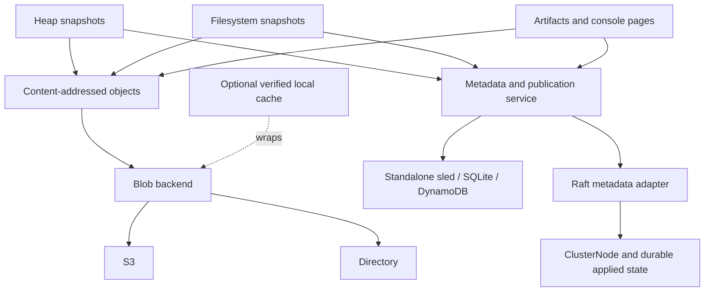

# Shared content-addressed storage and metadata

Status: proposal; documentation only. Stacked on
[#328](https://github.com/r33drichards/mcp-js/pull/328), which separates server
artifact/console payloads from their database references. This document does not
implement new formats, change configuration, enable SQLite-backed Raft, or claim
stronger consistency than the existing cluster provides.

## Problem and direction

Heap snapshots, filesystem snapshots, and runtime payloads share a useful write
pattern: store immutable bytes, then publish a mutable reference in metadata.
They currently implement object identity, configuration, publication, and cluster
routing in different places.

Extract three composable boundaries:

1. A blob backend responsible for bytes in a directory or S3, optionally cached.
2. A content-addressed object service responsible for identity, encoding, and
   verification over that backend.
3. A metadata service responsible for references, ordered indexes, conditional
   updates, and atomic companion writes. Raft is an optional implementation of
   this metadata boundary, with explicit consistency capabilities.

Domain services retain their own semantics: snapshots and reflogs, artifact
replacement, console ordering, execution lifecycle, and upload-grant redemption.
This is not one universal record schema or a plan to put payload bytes in Raft.

## Existing implementation

| Domain | Object identity / bytes | Metadata | Coordination today |
| --- | --- | --- | --- |
| Heap snapshots | SHA-256 of raw snapshot bytes; stored with a checksum envelope | Session history and heap tags | Standalone metadata or domain-specific cluster paths |
| Filesystem snapshots | BLAKE3-addressed chunks and serialized tree nodes; some file bytes inline inside object-store nodes | Label heads and reflogs | Database CAS or Raft CAS with atomic reflog companions |
| Runtime payloads in #328 | UUID-named `runtime/` objects; not yet content-addressed | Artifact keys and ordered console-page references; execution records and grants remain database values | Standalone database paths, including local sled in cluster deployments |

Relevant code:

- [`HeapStorage` and its directory/S3/cache implementations](../server/src/engine/heap_storage.rs).
  The trait is already generic named-blob I/O; it does not calculate hashes or
  enforce immutability. The directory implementation does not currently promise
  power-loss-safe publication.
- [`wrap_snapshot`](../server/src/engine/mod.rs) hashes the raw heap payload,
  then creates the stored checksum envelope. The key is not a hash of that envelope.
- [`FsStore`](../server/src/engine/fs_store.rs) hashes logical chunks before
  compression and tree-node encodings before persistence. Existing IDs and
  formats must survive extraction.
- [`RuntimeStore`](../server/metadata-store/src/runtime_tree.rs) provides the
  dedicated synchronous-to-async I/O bridge and #328's runtime references.
- [`MetadataStore`](../server/metadata-store/src/lib.rs) already supplies binary
  keys, scans, ID allocation, and CAS with atomic companion writes.
- [`LabelStore`](../server/src/engine/fs_labels.rs),
  [`SessionLog`](../server/src/engine/session_log.rs), and
  [`HeapTagStore`](../server/src/engine/heap_tags.rs) each contain cluster routing.
- [`ClusterNode`](../server/src/cluster.rs) implements consensus and stores its
  log/applied state in sled. Its client operations currently use string keys and
  values, rather than the binary `MetadataStore` interface.
- [`BlobStore` in FFI configuration](../server/src/engine/ffi_config.rs) already
  describes directory/S3 selection and cache paths. Reuse its concepts rather
  than introducing another incompatible configuration model with the same name.

## Proposed composition



The metadata publication service receives an object service and a metadata
backend. It coordinates writes; the lower-level blob backend does not know
about sessions, labels, database keys, Raft membership, or artifact names.

### Object interface sketch

Illustrative names and operations, not a proposed drop-in Rust API:

```text
ContentId = { format_version, object_kind, hash_algorithm, digest }
ObjectRef = { content_id, logical_size_bytes, encoding_version }

BlobBackend:
    put_immutable(object_key, stored_bytes) -> acknowledged
    get(object_key) -> stored_bytes

ContentObjects:
    put(kind, canonical_payload_bytes) -> ObjectRef
    get(ObjectRef) -> verified_payload_bytes

MetadataPublication:
    publish(primary_key, expected_revision, object_ref, companions)
        -> Committed(revision) | Conflict | UnknownOutcome | Error
```

`ObjectRef` is data stored in metadata, not a location capability supplied by a
client. Backend location and namespace come from engine configuration. Identity
must be independent of whether the backend is S3 or a directory. Keep new object
keys namespaced and versioned; do not reinterpret existing bare heap hashes,
filesystem prefixes, or #328 UUID references as the new format.

Hash canonical logical payload bytes, excluding mutable metadata. Define the
canonical payload and storage encoding for each version; reads decode the
supported envelope and verify the logical digest. A storage codec change must
not silently redefine an existing ID or overwrite it with incompatible bytes.
Preserve the existing SHA-256 and BLAKE3 conventions through explicit legacy
adapters before deciding whether new formats should share one algorithm.

Separate artifact MIME type, timestamps, ownership, and execution association
from the content digest. Console pages are immutable objects; their ordered index
stores stream identity, sequence/offset, length, and object reference. Identical
pages can share bytes without losing their separate positions in the stream.
Do not turn an append into repeated rewrites of the entire console history.

An initial extraction can adapt `HeapStorage`, but its arbitrary-name `put` is
not by itself the new immutable-write contract. Same-ID retries and concurrent
writers must be idempotent, and conflicting/corrupt existing objects must produce
an integrity error. Cache hits must satisfy the same identity checks as backend
reads; a cache must not mask a failed authoritative write.

### Metadata boundary and Raft adapter

Reuse `MetadataStore` operations where their semantics match; do not add a second
KV abstraction merely to rename them. Introduce a publication facade with
explicit revisions/outcomes and read capabilities before promising a common
strong-consistency API across all backends.

A future `RaftMetadataStore` needs:

- Collision-free encoding of namespace, tree, and binary key; versioned values
  and wire commands. Preserve existing domain-specific prefixes while migrating.
- Leader forwarding, committed publication acknowledgements, and atomic primary
  plus companion writes in one replicated entry. Object I/O happens before the
  proposal; state-machine application performs no S3/filesystem network I/O.
- Replicated, deterministic ID allocation or another ordering scheme that keeps
  existing session/reflog contracts. Do not allocate shared counters locally.
- Explicit local-committed reads versus barrier-protected reads. Unsupported
  stronger reads fail instead of being silently downgraded. Prefix scans are not
  automatically transactional snapshots.
- Durable applied state, replay/restart behavior, and serialization/transaction
  size limits enforced without automatic payload spillover.

Current cluster reads are local committed reads. A successful CAS is durably
applied, but a failed CAS can be a mismatch against pending state and is not a
linearizable ownership observation. An adapter cannot relabel that result as a
committed conflict. Preserve a provisional-conflict outcome or strengthen the
protocol and tests before using the stronger facade contract.

A timeout or lost response can leave publication committed even though the
caller did not observe success. Return an unknown outcome; retries need an
operation ID/idempotency record or an equivalent reconciliation protocol. A
reflog append or console append must not be duplicated by an uncertain retry.
Operation-ID retention and revision/tombstone rules must be settled before this
becomes an executable API.

SQLite and DynamoDB currently exclude Raft cluster mode in bootstrap. A Raft
adapter does not remove that restriction automatically. Replacing sled's Raft
log/state persistence with SQLite is a separate project from routing application
metadata through the existing Raft state machine. DynamoDB remains a standalone
coordinator using its own conditional/transactional writes.

## Publication and failure ordering

For a new artifact version, snapshot root, or console page:

1. Produce canonical bytes and calculate the content ID.
2. Persist all required immutable objects, including referenced children for a
   Merkle root, and receive the backend's durability acknowledgement.
3. Commit the primary metadata reference and required companions atomically,
   using the domain's expected revision or conditional append.
4. Acknowledge the operation only after metadata commitment.

| Failure point | Required behavior |
| --- | --- |
| Blob write fails | No new reference is published; return the error. Never switch storage backends or inline the bytes. |
| Blob succeeds, publication conflicts | Leave previous metadata intact. The new blob may be unreferenced. |
| Metadata reply is lost | Report unknown outcome and reconcile by operation ID; do not assume rollback. |
| Metadata references a missing/corrupt blob | Return availability/integrity failure. Do not substitute another object or backend. |
| Process crashes after success | References and their target objects must remain recoverable under the stated durability model. |

This is ordered publication across two systems, not a distributed transaction.
For directory storage, the stronger durability contract requires an appropriate
same-filesystem temporary-file publication protocol, file sync, and directory
sync. The current `std::fs::write` and process-kill tests do not establish
power-loss durability. S3 must acknowledge the object before the reference is
committed; checksum/address verification remains the object service's job.

Raft replicas receive metadata references, not blob contents. Every reader needs
access to the same bucket or shared filesystem, or a separately implemented blob
replication protocol. Replicating a reference to a leader-local file does not
make that file available on followers. Reject invalid cluster/local-storage
combinations unless that availability contract is explicitly supplied.

## Configuration, retention, and compatibility

Use one shared blob-backend configuration vocabulary for directory paths, S3
bucket, and optional cache. Preserve independent heap, filesystem-snapshot, and
runtime enablement and namespaces. #328's bucket-inference and runtime directory
remain compatibility defaults until an explicit configuration migration is
implemented. A cache lookup that fetches from its configured primary is distinct
from failing over to a different authoritative backend.

Migrate both server bootstrap and direct/FFI constructors. #328's direct local
constructors still retain inline behavior; a shared architecture must make that
choice explicit rather than accidentally leaving a second storage policy.

Keep existing objects and references readable. Write new versioned references
only after adding dual-format readers, and perform backend relocation through an
explicit copy/verification operation. Changing a bucket/path is not automatic
migration. No on-read missing-object fallback is introduced.

Reachability roots include labels/reflogs, retained session heap/fs references,
artifact versions, and retained console page indexes. The existing filesystem
GC recognizes only filesystem object prefixes; it is not a runtime/heap GC.
Content deduplication means deleting one reference cannot immediately delete its
blob. Defer shared sweeping until publication pins/leases, GC epochs, or an
explicit quiescence protocol protect concurrent writers and lagging readers.
A naive metadata scan plus an age threshold does not establish that safety.

## Suggested implementation stack

Each step should be reviewable independently and preserve existing wire formats
until its migration is explicitly introduced:

1. **Extract named blob I/O and common construction.** Adapt/rename `HeapStorage`
   internally, reuse directory/S3/cache implementations, and retain compatibility
   aliases plus the synchronous I/O bridge. Document and test durability first.
2. **Introduce typed content IDs and verified object I/O.** Add versioned runtime
   content-addressed objects, preserving heap/fs and UUID legacy readers. Separate
   artifact payload identity from artifact metadata; keep console page ordering.
3. **Unify publication contracts.** Add revisions, operation IDs, explicit read
   capabilities, and atomic companion publication for standalone metadata.
4. **Add the Raft metadata adapter.** Address binary encoding, replicated counters,
   provisional conflicts, unknown outcomes, and read barriers; migrate one domain
   at a time. Do not change Raft persistence backends as part of this step.
5. **Converge configuration and constructors, then retention.** Cover CLI, config,
   environment and FFI behavior; retire duplicate paths only after parity tests.
   Design safe shared GC separately before deleting unreferenced objects.

## Red-to-green validation plan

- Shared object contracts for memory, directory and disposable S3: deterministic
  IDs, identical-content retries/concurrent puts, corruption rejection, versioned
  decoding, codec round-trips, and authoritative-write/cache failure behavior.
- Metadata contracts for each backend: size-limit rejection, binary/namespace
  isolation, durable publication, conditional replacement, atomic companions,
  tombstones/revisions, and operation-ID reconciliation after uncertain replies.
- Domain integration tests: heap restore, filesystem root/reflog recovery,
  artifact metadata updates without payload duplication, console pagination across
  page boundaries and restarts, and grant single-use behavior.
- Publication fault tests: fail object writes, crash between object and reference
  publication, lose commit replies, and reopen with independent handles. Distinguish
  process crashes from filesystem power-loss guarantees.
- Existing standalone cluster and deterministic-simulation tests: concurrent
  publication, partitions, leader replacement, replay, pending-CAS conflicts, and
  no ownership assertions from stale reads. Reuse the stack described in
  [Raft conformance research](raft-conformance-research.md), verifying which
  harnesses are actually present on the implementation branch.
- Availability tests: a follower with a valid reference can fetch and verify the
  object; a node with only another node's private directory cannot report success.
- Future GC tests must race publication and retained readers with collection;
  they are prerequisites for enabling shared deletion, not evidence supplied by
  this proposal.

The first implementation PR should be the behavior-preserving extraction and
contract tests, rather than a simultaneous rewrite of hashing, metadata schemas,
configuration, and consensus.
