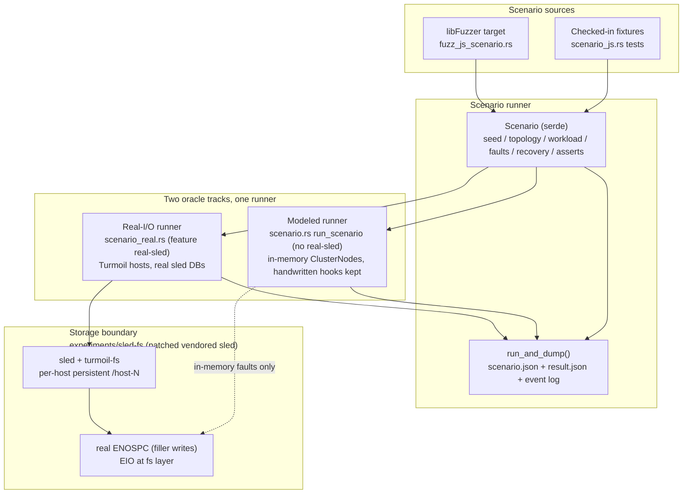
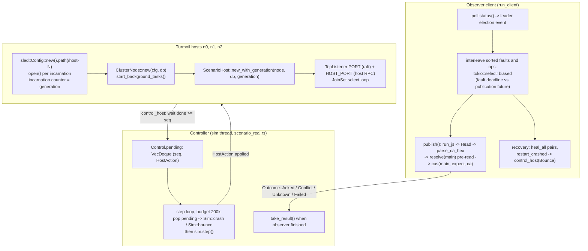
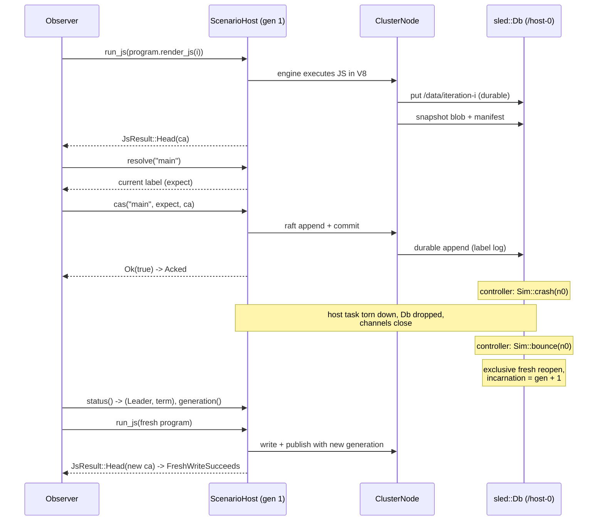
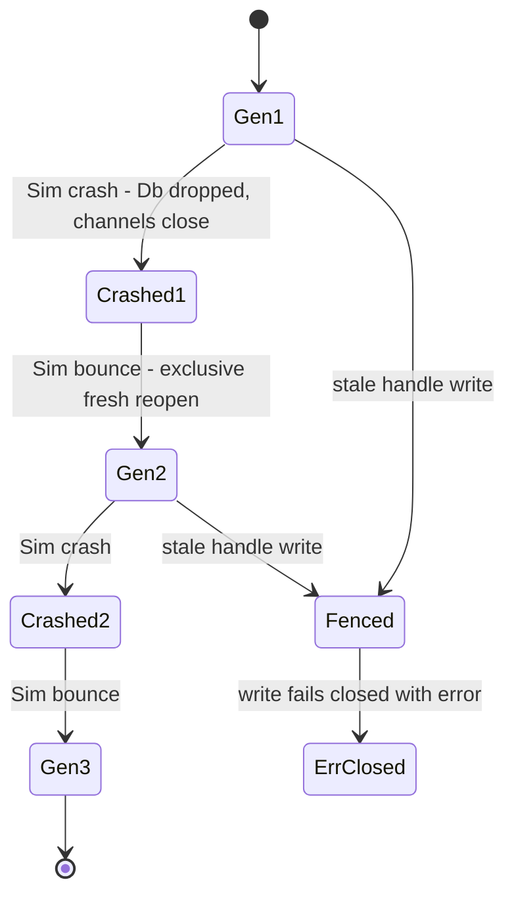
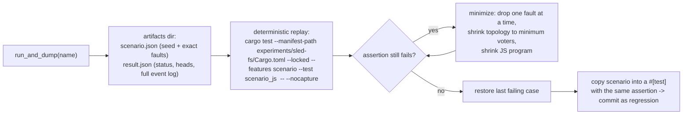

# Scenario harness architecture (in detail)

Companion to README.md (explainer) and the three SVGs. This document goes
component-by-component with file paths, struct names, exact flows, and the
guarantees each layer provides. Everything below refers to the
`feat/scenario-real-sled` branch (PR #336, stack #312 -> #322 -> #336).

## 1. The full stack

The runner is the single entry point: `Scenario::run_and_dump(name)`
calls `run_scenario`, which under `feature = "real-sled"` delegates to
`scenario_real::run_scenario`, otherwise to the modeled runner. Both return
a `ScenarioResult` (status, acked / attempted / unknown / failed heads,
events) and both drive the same assertion list.

## 2. Scenario schema and semantics

`engine-cluster-tests/src/scenario.rs`:

- `Scenario { seed, topology, workload, faults, recovery, asserts }`
- `Topology { voters: Vec<String>, clients: Vec<String> }` - bounded; the
  real runner fixes voters to n0/n1/n2 and one observer client.
- `Workload { every_ms, count, op }`; `Op::RunJs { node, program }` where
  `node` resolves `"leader"` against the elected leader, or
  `Op::RunJsUnmodeled { source }` for arbitrary JS (separate oracle: JS
  exceptions and engine timeouts are first-class outcomes, not failures).
- `Program(Vec<Step>)`; `Step::Write { path, bytes }` with `{i}`
  iteration substitution; `render_js(i)` emits the JS that writes the file,
  snapshots, and publishes the shared label CAS.
- `Fault::Crash { at_ms, node: CrashTarget }` (`Node(name)` or
  `CurrentLeader`), `Fault::Partition { groups }` (groups may name
  `"current_leader"`; the sitting leader is excluded from any group that
  does not contain it), `Fault::HealAll`.
- `Recovery { stop_workload, heal_all, restart_crashed, deadline_ms }`.
- Assertion ids: `FreshWriteSucceeds`, `AckedCommitsInLegalHistory`,
  `ReplicasConvergeAfterRecovery`, `PublishedSnapshotMatchesModel`.

## 3. Real-I/O runner: control flow

Key points:

- **Controller-only faults.** Hosts cannot crash themselves or each other.
  A host that needs a fault applies `control_host(&control, HostAction)`,
  pushes `(seq, action)` and awaits `control.done >= seq`; the controller
  loop executes `sim.crash`/`sim.bounce` and acknowledges by sequence
  number. Partition/heal pairs are applied directly by the observer via
  `turmoil::partition`/`repair` (network faults, not process faults).
- **Leader resolution.** `CrashTarget::CurrentLeader` and
  `Partition["current_leader"]` resolve by polling
  `ScenarioHostClient::status()` across the voters at fault time.
- **Publication vs fault race.** While an op is in flight, the observer
  runs `tokio::select!` biased between the next fault deadline and the
  publication future - so a scheduled crash lands mid-publication rather
  than silently after it (verified by
  `scheduled_crash_interrupts_in_flight_js_publication`).
- **Outcome classes.** `Acked` (CAS moved the label),
  `Conflict` (label already at this head or CAS lost), `Unknown` (CAS
  errored - outcome genuinely uncertain), `Failed` (JS exception, timeout,
  bad head). A timeout is never interpreted as a non-commit; unknown
  outcomes are reconciled by re-reading `resolve(main)` before counting.

## 4. Publication, crash, and reopen

Guarantees exercised here:

- A pre-crash acknowledged commit stays in the legal Raft history
  (`AckedCommitsInLegalHistory`); `FreshWriteSucceeds` demands a *distinct*
  acknowledged post-recovery head and rejects prior/same-head
  acknowledgments, retrying uncertain outcomes.
- The reopened host must be *ready* before the restart event is recorded
  (`FreshReopenGenerationReady` before `Restart` in the event log).
- Two crashes must produce two distinct acknowledged snapshots
  (`owner_two_crashes_keep_distinct_acknowledged_js_snapshots`, gens 1->2->3).

## 5. Generation fencing (storage ownership)

Ownership rules, each enforced by a named regression:

| Rule | Enforcing test |
| --- | --- |
| Only the host runtime touches sled; workers get channel clones only | `blocking_worker_blobs_are_flushed_by_host_and_reopen` |
| Dropping the host aborts its blob pump | `dropping_scenario_host_stops_its_blob_pump` |
| Pre-crash completed console output is durable across reopen | `stale_console_writer_is_fenced_after_fresh_reopen` |
| A pre-crash captured writer cannot write post-reopen | `stale_console_writer_is_fenced_after_fresh_reopen` (writer is fenced: `Err`, not silently lost) |
| Cached handles fail closed after crash | same suite + `execution_registry_reuses_host_owned_persistent_sled` |
| Observer/hosts never exchange handles, only serialized RPC | `observer_runs_js_and_publishes_label_on_host`, `host_owned_engine_runs_js_on_patched_sled` |
| Malformed snapshot heads are errors, not absent files | `invalid_snapshot_head_is_not_reported_as_absent_file` |

Under the hood (server/src/engine): `HostBlobStorage` is an mpsc bridge
(`channel(16)` + pump future) over `SledHeapStorage` (blobs in the
`fs_blobs` tree, flushed on put/delete); `HostConsoleBridge` is an
unbounded channel with an `AtomicBool alive` revocation flag;
`write_page` fails with "console owner generation revoked" when revoked and
"console owner stopped" when the owning host is gone. `ConsoleLogState`
buffers per V8 thread (`RefCell`, single-threaded) and flushes WAL-style
pages by size.

## 6. Storage boundary proofs

The vendored sled in `experiments/sled-fs/sled` is patched for Turmoil's
filesystem (0.7.2, `unstable-fs`): strict directory model, no temporary
paths, faults surface through the real sled code paths. Named proofs:

- `storage.rs`: `enospc_reaches_real_sled_log_flush`,
  `eio_reaches_real_sled_config_write`,
  `crash_discards_pending_blob_bytes_written_by_sled`,
  `crash_recovery_without_destructor_flush`,
  `rejects_background_flusher_and_relative_paths`,
  `roundtrip_blobs_and_host_isolation`.
- `cluster.rs`: disk-full Raft node - append rejected while full, real
  ENOSPC from `db.flush()`, node stops ("cluster stopped or storage
  failed"), recoverable on reopen when space returns.
- `multi_node.rs`: `real_three_node_quorum_survives_disk_full_and_crash_reopen`
  - a real filler write exhausts a 32-KiB simulated disk on a live
  three-node cluster; quorum keeps committing and the reopened host catches up.
- `recovery.rs`: `disk_full_crash_reopen_preserves_ack_and_allows_fresh_progress`.

## 7. Artifacts, replay, minimization

Artifacts are the contract: a failure must replay without fuzzing, and a
minimized scenario is checked in as the regression (see README.md for the
exact commands).

## 8. CI and verification matrix

`.github/workflows/sled-fs-proof.yml` (toolchain 1.100,
`RUSTFLAGS=--cap-lints warn`) runs, in order:

1. `cargo test --features cluster` - real three-node Raft over turmoil TCP.
2. `cargo test --features scenario --test scenario_js` - the 13 real-sled
   scenario regressions (single-threaded).
3. `cargo test` (default features) - storage proofs.
4. `cargo test -p sled --features testing --lib --test test_log --test test_tree`
   - patched vendored sled's own suites.

Measured on `feat/scenario-real-sled`: scenario_js 13/13, cluster suite
green, storage/multi_node/recovery green, sled 66/66, server lib 299/299,
turmoil_engine (real-sled) 1/1. Milestone-6 hook audit and results:
`experiments/sled-fs/VALIDATION.md`.
