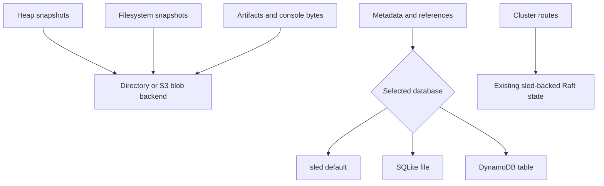

# Storage backends

mcp-v8 separates **blob storage** from **metadata storage**. Choosing SQLite or
DynamoDB does not move snapshot bytes into that database or replace the Raft log.
Heap and filesystem persistence are independent, disabled-by-default axes.

## Select each persistence axis explicitly

| Data | Selector | Default |
|---|---|---|
| V8 heap snapshots | `--heap-store none|dir|s3` | `none` |
| Content-addressed filesystem snapshots | `--fs-store none|dir|s3` | `none` |
| Session/tag/label and runtime metadata | `--sqlite-path` or `--dynamodb-table` | sled |
| Artifact and console payloads | `--s3-bucket`, otherwise local files | `<session-db-path>/runtime-blobs` |

`--heap-dir` applies when `--heap-store dir`; its default is
`/tmp/mcp-v8-heaps`. `--fs-dir` applies when `--fs-store dir`; its default is
`<session-db-path>/fs-blobs`. Setting a directory or bucket alone does not enable
heap or filesystem persistence. Runtime payloads still need storage when both
snapshot axes are `none`.

## Shared blob interface

`BlobStorage` is the named-blob boundary; `HeapStorage` remains a compatibility
name. Directory, S3, memory, and write-through cache implementations support the
shared interface. Snapshot identity remains domain-specific: heap payloads use
SHA-256 and filesystem trees/chunks use BLAKE3. New runtime payloads have typed
SHA-256 references under `runtime/v2/`.

Directory writes use a sibling temporary file, sync its contents and required
directory entries, then publish it atomically. Immutable writes accept identical
existing content and reject conflicts. A metadata reference is published only
after its payload write succeeds.

## S3 and the local write-through cache

S3 clients use the normal AWS credential chain and an existing bucket. All
processes sharing references must be able to access the corresponding objects.
A local cache is an optimization, not an alternate authoritative backend.

With `--cache-dir`, writes reach the primary first. Mutable `put` reports a
subsequent cache write failure; immutable `put_immutable` acknowledges a durable
primary even if cache population fails. Reads check the cache first, fetch the
primary on a miss, and populate the cache best-effort. Cache fills and repairs
install complete files atomically, so readers do not see a truncated rewrite.

The default cache budget is 512 MiB. Filesystem prefetch uses a shared I/O budget
and temporary staging reservations; see [filesystem snapshots](fs-snapshots.md).
A cache failure never silently switches the primary from S3 to local storage.

## Metadata and durability

Session history is attached when heap or filesystem persistence is enabled.
Heap tags require heap persistence; filesystem labels require filesystem
persistence. Execution records, artifact metadata, console descriptors, and
upload grants have their own runtime store in every mode.

Sled paths live under `--session-db-path` (default `/tmp/mcp-v8-sessions`), with
separate tag/label stores and a per-port execution store for HTTP deployments.
SQLite namespaces those records inside one configured file; DynamoDB namespaces
them in its configured table. Durable records do not restore an in-flight V8
isolate or transfer its cancellation handle to another process.

`--sqlite-path` and `--dynamodb-table` conflict with one another and with ordinary
Raft cluster mode. Neither supplies Raft persistence. The optional Rust
`RaftMetadataStore` API does not automatically migrate existing domain routes.

For backups, preserve both the selected metadata and its referenced blob store.
A surviving reference cannot reconstruct a missing blob. `/tmp` paths are not a
reboot-durability plan. Existing sled data is not migrated by changing selectors.

## See also

- [Configure heap storage](../how-to/storage-backends.md)
- [Configure metadata backends](../how-to/metadata-backends.md)
- [Runtime payloads and publication](runtime-storage.md)
- [Heap snapshots](sessions-and-heaps.md)
- [Clustering](clustering.md)
